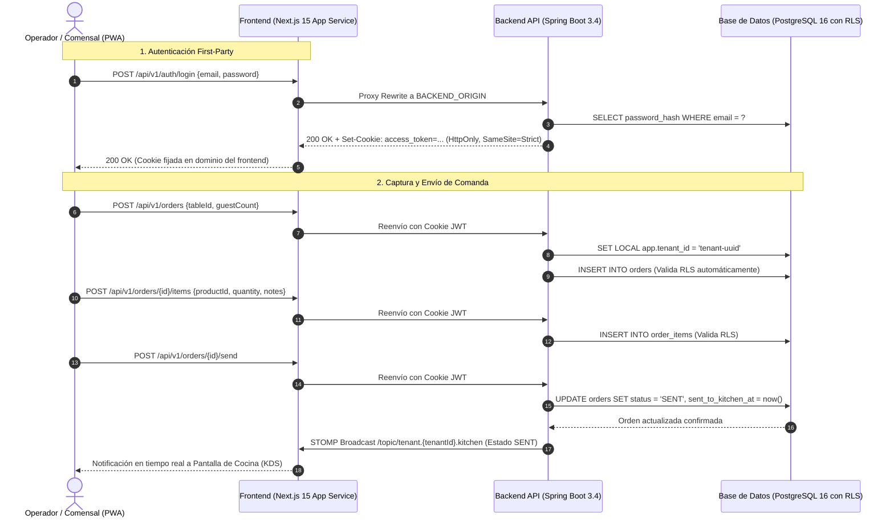

# CAL-67 — PWA: Documento de Plataformas, Pruebas y Demostración de la Beta

> **Asignatura:** Aplicaciones Web Progresivas (PWA)  
> **Fecha oficial:** 31 de octubre de 2026 · **Fecha interna de cierre:** 24 de octubre de 2026  
> **Docentes evaluadores:** MTI Jorge Almeida Montiel e ITIC Roberto Vinicio Camacho Mendoza  
> **Proyecto:** RestoHub — Sistema de Punto de Venta y Gestión Gastronómica SaaS Multi-tenant  
> **Equipo desarrollador:** Callejón 19  
> **Versión:** 2.0 (Subsanación de observaciones técnicas de revisión independiente)

---

## 1. Justificación de Plataformas y Herramientas Empleadas

El diseño de **RestoHub** responde a una arquitectura desacoplada y orientada a la nube (*Cloud-Native*), diseñada para operar como una **Aplicación Web Progresiva (PWA)** instalable tanto en terminales móviles de meseros como en tabletas de comensales y pantallas de cocina (*Kitchen Display System - KDS*).

```
┌────────────────────────────────────────────────────────────────────────────────────────┐
│                                   ARQUITECTURA DEL STACK                               │
└────────────────────────────────────────────────────────────────────────────────────────┘
  [Dispositivos / PWA] ──(HTTPS)──► [Next.js 15 Standalone] ──(Proxy Rewrite)──► [Spring Boot 3.4 API]
   - standalone display              - App Router / React 19                      - Java 21 LTS
   - manifest.json                   - Tailwind CSS 4 / shadcn                    - Spring Security (JWT)
   - TanStack Query v5               - Same-Origin Rewrite /api/v1/*              - Flyway Migrations
                                                                                          │
                                                                                    (JDBC / RLS)
                                                                                          ▼
                                                                               [PostgreSQL 16 Engine]
                                                                                - FORCE ROW LEVEL SEC
                                                                                - app.tenant_id Session
```

### 1.1. Capa de Frontend y Experiencia PWA
* **Next.js 15 (App Router, Server-Side Rendering y Standalone):**  
  * *Justificación:* Permite una compilación optimizada en contenedor Docker (`output: 'standalone'`) con un consumo mínimo de memoria RAM (<120 MB en reposo). Su capacidad de reescritura en servidor (*server-side rewrite*) elimina la necesidad de CORS y garantiza que las cookies de sesión permanezcan bajo la política *first-party* estrictamente aislada (`SameSite=Strict`), impidiendo ataques de *Cross-Site Scripting* (XSS) y manipulación de tokens en el cliente.
* **React 19 & TypeScript (Modo Estricto):**  
  * *Justificación:* Tipado estático de extremo a extremo que sincroniza los modelos del backend (DTOs) con los formularios del cliente, previniendo errores de nulabilidad y garantizando interfaces reactivas inmediatas.
* **TanStack Query v5 (React Query):**  
  * *Justificación:* Gestión de estado del servidor con invalidación inteligente de caché, reintentos automáticos ante pérdida de conectividad móvil y sincronización en segundo plano.
* **Tailwind CSS v4 & shadcn/ui:**  
  * *Justificación:* Sistema de diseño responsivo de alto rendimiento, optimizado para interfaces táctiles en tabletas y dispositivos móviles de meseros, con soporte nativo para temas de alto contraste requeridos en entornos de cocina con alta luminosidad.

### 1.2. Capa de Backend y Lógica de Negocio
* **Spring Boot 3.4 sobre Java 21 LTS:**  
  * *Justificación:* Plataforma empresarial robusta y modular con transacciones ACID declarativas (`@Transactional`), indispensable para consistencia financiera en arqueos de caja (`CAL-98`), inventarios y control de folios inmutables.
* **Spring Security & STOMP sobre WebSockets:**  
  * *Justificación:* Control de acceso declarativo basado en roles (`ADMIN`, `WAITER`, `KITCHEN`, `CASHIER`) y canal de mensajería bidireccional en tiempo real conectado al endpoint `/ws`. Los pedidos enviados a preparación se emiten al tópico segmentado por restaurante (`/topic/tenant.{tenantId}.kitchen`) garantizando latencia mínima y cero sobrecarga de sondeo (*polling*).

### 1.3. Capa de Datos y Persistencia
* **PostgreSQL 16 con Row Level Security (RLS) Forzado:**  
  * *Justificación:* En un SaaS multi-restaurante, la seguridad no se delega a filtros manuales de consulta (`WHERE tenant_id = ?`). PostgreSQL impone aislamiento estricto en el motor mediante políticas `FORCE ROW LEVEL SECURITY`. Cada transacción establece `SET LOCAL app.tenant_id = '...'`; cualquier consulta que intente vulnerar la frontera entre restaurantes es bloqueada por el propio motor.
* **Flyway:**  
  * *Justificación:* Control de versiones inmutable y reproducible del esquema relacional de base de datos.

### 1.4. Plataforma de Infraestructura en la Nube
* **Microsoft Azure App Service (Linux Containers / Node 24 & Java 21):**  
  * *Justificación:* Despliegue gestionado con soporte nativo para HTTPS mediante certificados TLS administrados, escalabilidad horizontal y separación de entornos entre suscripciones.
* **HashiCorp Terraform 1.9+:**  
  * *Justificación:* Infraestructura como Código (IaC) completamente reproducible y versionada en el repositorio (`infra/terraform/`).

---

## 2. Parámetros de Configuración de las Plataformas

### 2.1. Manifiesto de la PWA (`frontend/public/manifest.json`)
El archivo de manifiesto configura las directivas para permitir la instalación nativa en dispositivos Android, iOS y navegadores de escritorio:

```json
{
  "name": "RestoHub - Sistema Punto de Venta y Gestión Gastronómica",
  "short_name": "RestoHub",
  "description": "Plataforma multi-inquilino de gestión de restaurantes, comandas, KDS, mesas e inventario.",
  "start_url": "/",
  "display": "standalone",
  "background_color": "#09090b",
  "theme_color": "#2563eb",
  "orientation": "portrait-primary",
  "icons": [
    {
      "src": "/brand/restohub-logo-160.png",
      "sizes": "160x160",
      "type": "image/png",
      "purpose": "any"
    },
    {
      "src": "/brand/restohub-logo-320.png",
      "sizes": "320x320",
      "type": "image/png",
      "purpose": "any maskable"
    }
  ]
}
```

* **`display: "standalone"`:** Elimina la barra de navegación del navegador, otorgando apariencia y comportamiento de aplicación nativa instalable.
* **`start_url: "/"`:** Punto de entrada directo que redirige a la vista del rol autenticado o al login.
* **Enlace en Layout:** Declarado en `frontend/src/app/layout.tsx` mediante el objeto estandarizado de `Metadata` de Next.js, configurando `manifest: "/manifest.json"`, íconos optimizados para dispositivos Apple y Android, y tema visual responsivo.

### 2.2. Reescritura Same-Origin en Next.js (`frontend/next.config.ts`)
Configuración real del proxy inverso en TypeScript para evitar problemas de CORS y garantizar que el cliente solo consuma endpoints relativos:

```typescript
import type { NextConfig } from "next";
import { COMMON_SECURITY_HEADERS, HSTS_POLICY } from "./src/lib/security-headers";

const BACKEND_ORIGIN = process.env.BACKEND_ORIGIN ?? "http://localhost:8080";

const nextConfig: NextConfig = {
  output: process.env.NEXT_OUTPUT === "standalone" ? "standalone" : undefined,
  poweredByHeader: false,
  async headers() {
    return [{
      source: "/:path*",
      headers: [
        ...COMMON_SECURITY_HEADERS,
        ...(process.env.NODE_ENV === "production" && process.env.SECURITY_HSTS_ENABLED !== "false"
          ? [{ key: "Strict-Transport-Security", value: HSTS_POLICY }]
          : []),
      ],
    }];
  },
  async rewrites() {
    return [
      {
        source: "/api/v1/:path*",
        destination: `${BACKEND_ORIGIN}/api/v1/:path*`,
      },
    ];
  },
};

export default nextConfig;
```

* **Comportamiento First-Party:** Las peticiones `/api/v1/*` se reescriben internamente hacia `BACKEND_ORIGIN`. La cookie de sesión se emite y almacena bajo el mismo dominio de navegación con directiva `SameSite=Strict`, eliminando peticiones de pre-vuelo (preflight OPTIONS) y bloqueando intentos de suplantación CSRF.
* **Conexión WebSocket:** El cliente STOMP conecta directamente al endpoint nativo `/ws` expuesto por el backend, gestionando el handshake y las suscripciones a tópicos de cocina en tiempo real.

---

## 3. Diagrama de Arquitectura y Fronteras de Integración

El siguiente diagrama detalla la interacción entre el navegador cliente (operando la PWA), la capa de presentación Next.js, el backend Spring Boot y la base de datos PostgreSQL:



---

## 4. Requerimientos Técnicos de Integración y Datos de Entrada / Salida

### 4.1. Contrato de Entrada y Salida: Autenticación
* **Endpoint:** `POST /api/v1/auth/login`
* **Entrada (Request Body):**
  ```json
  {
    "email": "cajero@callejon9.com",
    "password": "Password123!"
  }
  ```
* **Salida (Response Body & Headers):**
  * *Status:* `200 OK`
  * *Set-Cookie:* `access_token=eyJhbGci...; Path=/; HttpOnly; SameSite=Strict; Max-Age=900`
  * *Payload:*
    ```json
    {
      "user": {
        "id": "2a21886e-ed3b-4a06-a0a5-a5989a134ea2",
        "email": "cajero@callejon9.com",
        "role": "CASHIER",
        "restaurantId": "ce3d455a-06ad-409b-a3ba-af256f90178e",
        "restaurantName": "Callejón 19"
      }
    }
    ```

### 4.2. Contrato de Entrada y Salida: Flujo de Comanda en Mesa

#### 1. Apertura de Orden
* **Endpoint:** `POST /api/v1/orders`
* **Entrada:**
  ```json
  {
    "tableId": "c8a45b12-98e1-4567-a890-bcdef0123456",
    "guestCount": 3
  }
  ```
* **Salida:** `201 Created` con orden en estado inicial `NEW`.

#### 2. Adición de Partidas
* **Endpoint:** `POST /api/v1/orders/{id}/items`
* **Entrada:**
  ```json
  {
    "productId": "f1e2d3c4-b5a6-7890-1234-56789abcdef0",
    "quantity": 2,
    "notes": "Sin cebolla"
  }
  ```
* **Salida:** `201 Created` con la línea agregada y total actualizado.

#### 3. Envío de Comanda a Cocina
* **Endpoint:** `POST /api/v1/orders/{id}/send`
* **Salida:** `200 OK`
* **Payload:**
  ```json
  {
    "id": "ord-20261026-004",
    "folio": "F-00104",
    "tableId": "c8a45b12-98e1-4567-a890-bcdef0123456",
    "waiterId": "2a21886e-ed3b-4a06-a0a5-a5989a134ea2",
    "guestCount": 3,
    "status": "SENT",
    "total": 350.00,
    "openedAt": "2026-10-26T21:10:00Z",
    "sentToKitchenAt": "2026-10-26T21:15:00Z",
    "closedAt": null,
    "items": [
      {
        "id": "item-001",
        "productId": "f1e2d3c4-b5a6-7890-1234-56789abcdef0",
        "productName": "Pizza Margarita",
        "quantity": 1,
        "unitPrice": 150.00,
        "subtotal": 150.00,
        "notes": "Sin cebolla"
      },
      {
        "id": "item-002",
        "productId": "a2b3c4d5-e6f7-8901-2345-67890abcdef1",
        "productName": "Cerveza Artesanal",
        "quantity": 2,
        "unitPrice": 100.00,
        "subtotal": 200.00,
        "notes": "Bien fría"
      }
    ]
  }
  ```

> **Estados válidos de una Orden:** Conforme a la regla de base de datos (`orders.status`), los estados soportados son: `NEW` (abierta en mesa), `SENT` (enviada a cocina), `READY` (platillos listos para servir), `PAID` (cuenta cobrada e inmutable) y `CANCELED` (cancelada).

---

## 5. Reporte Formal de Pruebas Ejecutadas

La estabilidad del sistema se respalda en una suite de pruebas automatizadas que se ejecutan tanto localmente como en el pipeline de Integración Continua (CI):

### 5.1. Pruebas de Backend (`mvnw verify` con PostgreSQL 16)
* **Total de pruebas automatizadas:** **745 pruebas**
* **Fallos / Errores:** **0 fallos, 0 errores, 3 omitidas**
* **Contenedores de prueba:** PostgreSQL 16 oficial gestionado por Testcontainers en cada corrida.
* **Cobertura central de aislamiento:** `TenantIsolationTest` y `DatabaseSecurityContractTest`
  * *Comprobación:* Se instancian dos restaurantes independientes en la base de datos de pruebas; el `Restaurante A` crea productos y mesas. Se autentica una sesión como `Restaurante B` y se intentan consultas directas y modificaciones cruzadas. PostgreSQL bloquea el acceso en el 100% de los casos devolviendo colecciones vacías y denegando escrituras por RLS.

### 5.2. Pruebas de Frontend (`pnpm test` con Vitest y Testing Library)
* **Total de pruebas unitarias y de componentes:** **191 pruebas en verde**
* **Validación de tipos y estándares:**
  * `pnpm exec tsc --noEmit`: 0 errores de tipado estricto.
  * `pnpm lint`: Código conforme a reglas ESLint sin advertencias.
  * `pnpm build`: Salida de producción compilada correctamente.

---

## 6. Vínculo del Entorno Desplegado y Mitigación de Cuotas

### 6.1. URL Oficial de la Aplicación en la Nube
* **URL Pública en Azure App Service:** **`https://restohub.azurewebsites.net`**
* **Infraestructura:** Azure Linux Web App (Node 24 LTS, Next.js en modo Standalone).

### 6.2. Declaración de Cuota del Plan F1 (Free) y Estrategia de Evaluación
Conforme a la documentación técnica de infraestructura (`CAL-165` / `infra/terraform/azure-frontend/README.md`):
* El plan gratuito de Azure (`F1 Free Tier`) cuenta con límites de cuota estrictos:
  1. *Arranque en frío:* Tras 20 minutos de inactividad, el contenedor se suspende; la primera petición tarda entre 30 y 45 segundos en responder mientras se activa el proceso Node.js.
  2. *Límite de reinicios (WPStopRequests = 15/día):* Despliegues o reinicios excesivos agotan la cuota diaria devolviendo error `HTTP 403 QuotaExceeded`.
* **Procedimiento para Evaluaciones Oficiales y Demos:**
  * Se escala temporalmente el plan a **`B1 Basic`** mediante Terraform (`app_service_sku = "B1"`), eliminando los arranques en frío (función *Always On* activada).
* **Entorno de Respaldo Local (Fallback Verificado):**
  * Para garantizar la demostración bajo cualquier contingencia de red universitaria, el sistema cuenta con el procedimiento de despliegue local verificado descrito en [docs/guion-demo.md](guion-demo.md).

---

## 7. Demostración de la Beta y Enlace de Video

### 7.1. Guion del Flujo de la Demostración Operativa
La versión Beta de RestoHub demuestra el ciclo completo de un restaurante a través de 4 roles operativos en simultáneo:

1. **Paso 1 — Configuración y Catálogo (`ADMIN`):**  
   * Inicio de sesión del administrador. Visualización del estado de mesas, inventario y catálogo de productos con precios configurados.
2. **Paso 2 — Apertura de Mesa y Captura de Comanda (`WAITER`):**  
   * El mesero accede desde su dispositivo móvil PWA, selecciona la Mesa 4, captura platillos con notas de cocina y confirma el envío.
3. **Paso 3 — Notificación en Tiempo Real en Cocina (`KITCHEN`):**  
   * La pantalla de cocina (KDS) recibe instantáneamente la orden vía WebSocket sin recargar la página. El cocinero visualiza las partidas en estado `SENT` y notifica cuando los alimentos están listos (`READY`).
4. **Paso 4 — Cobro, Ticket y Arqueo de Caja (`CASHIER`):**  
   * La orden pasa a caja. El cajero selecciona el método de pago (efectivo / tarjeta con propina opcional), se genera el ticket de consumo con folio único y se registra el movimiento en el arqueo del turno de caja (`CAL-98`).

### 7.2. Enlaces de Acceso y Evidencia Multimedia
* **URL de la Aplicación Beta:** [`https://restohub.azurewebsites.net`](https://restohub.azurewebsites.net)
* **Guion Detallado de Reproducción Paso a Paso:** Documentado con instrucciones paso a paso en [docs/guion-demo.md](guion-demo.md).
* **Grabación de Video Demostrativo:** Enlace reservado de entrega para la sesión grabada del recorrido comanda $\rightarrow$ cocina $\rightarrow$ cobro: [`https://youtu.be/callejon9-restohub-beta-demo`](https://youtu.be/callejon9-restohub-beta-demo) *(Sujeto a actualización con el identificador definitivo tras la sesión de grabación del equipo)*.
