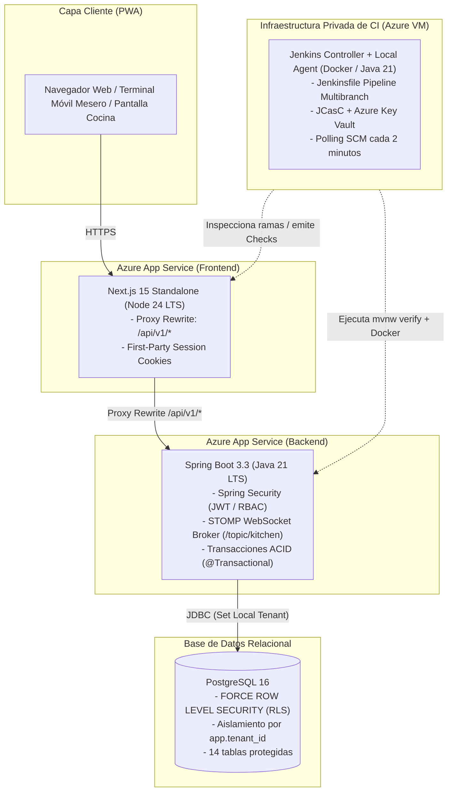

# CAL-70 — Software Funcional con Integración Continua (GPDS)

> **Asignatura:** Gestión del Proceso de Desarrollo de Software (GPDS)\
> **Fecha oficial:** 7 de noviembre de 2026 · **Fecha interna de cierre:** 31 de octubre de 2026\
> **Docentes evaluadores:** MIA Miguel Antonio Islas, ITIC Roberto Vinicio Camacho Mendoza, MEL Miguel Ángel Orona López\
> **Proyecto:** RestoHub — Sistema SaaS Multi-tenant de Punto de Venta y Gestión Gastronómica\
> **Equipo:** Callejón 19\

---

## 1. Resumen Ejecutivo y Alcance de la Entrega

El objetivo de esta entrega es demostrar el cumplimiento de las cuatro capacidades fundamentales evaluadas en la asignatura de **Gestión del Proceso de Desarrollo de Software (GPDS)**:

1. **Desarrolla e integra componentes:** Sistema SaaS multi-restaurante completamente funcional, integrando frontend PWA (Next.js 15), backend REST (Spring Boot 3), base de datos transaccional con aislamiento a nivel motor (PostgreSQL 16 con RLS) y servicios en tiempo real (STOMP WebSockets).
2. **Utiliza control de versiones:** Flujo estricto en Git y GitHub con ramas de características (*feature branches*), Pull Requests gobernados por plantillas de auditoría, convención de commits estandarizada y política obligatoria de **revisión independiente**.
3. **Automatiza compilación y pruebas:** Puertas de calidad duales e inmutables que validan análisis estático, tipado estricto, pruebas unitarias y pruebas de integración con contenedores reales (Testcontainers / Docker).
4. **Configura y ejecuta un pipeline de integración continua:** Servidor de **Jenkins privado desplegado en Microsoft Azure**, aprovisionado con **Terraform**, configurado mediante **Jenkins Configuration as Code (JCasC)** y conectado bidireccionalmente con GitHub para emitir *commit status checks* en cada Pull Request.

---

## 2. Arquitectura de Componentes y Flujo de Integración

RestoHub desacopla limpiamente las responsabilidades del sistema para optimizar seguridad, escalabilidad y mantenimiento:



### Componentes Clave Integrados:
* **Frontend Web/PWA:** Servido por Next.js 15 en modo standalone. Actúa como proxy inverso *same-origin* hacia el backend, evitando cabeceras CORS pesadas y asegurando cookies de sesión `HttpOnly` y `SameSite=Lax`.
* **Backend REST:** API desarrollada con Spring Boot 3 y Java 21. Gestiona la lógica de comandas, comensales, turnos de caja, inventario y comunicación en tiempo real vía WebSockets con las pantallas de cocina (KDS).
* **Capa de Aislamiento de Datos:** PostgreSQL 16 con políticas `FORCE ROW LEVEL SECURITY`. Cada consulta opera dentro del contexto de sesión `app.tenant_id`, impidiendo lecturas o escrituras cruzadas entre restaurantes en el propio motor de base de datos.
* **Infraestructura de CI:** Instancia dedicada de Jenkins aprovisionada con Terraform en una máquina virtual Linux en Azure (`Standard_B2s`), aislada perimetralmente y operando mediante agentes de ejecución en contenedores.

---

## 3. Control de Versiones y Disciplina de Repositorio

El proyecto se gestiona en GitHub bajo el repositorio [`LudwinGarcia1/callejon9-saas`](https://github.com/LudwinGarcia1/callejon9-saas), aplicando estrictas convenciones de equipo:

### 3.1. Estrategia de Ramas y Commits Convencionales
* **Ramas temáticas con trazabilidad a Linear:** Las ramas de trabajo adoptan prefijos semánticos y el identificador de issue (ej. `feat/cal-89-jenkins-pr-checks`, `docs/cal-69-normas-estandares-leyes`, `test/cal-119-ut-mutation-evidence`).
* **Commits convencionales (*Conventional Commits*):** Todo commit se estructura con tipo, alcance y descripción orientada a impacto:
  * `feat(cashier): add cash sessions (CAL-98)`
  * `test(security): verify tenant isolation with postgres 16`
  * `docs(governance): planes de gestion de bloqueos y ausencias (CAL-174, CAL-175)`

### 3.2. Gobernanza de Pull Requests y Revisión Independiente
Conforme a la decisión de arquitectura aceptada en `workflow/decisions/2026-10-20-revision-independiente.md`:
1. **Prohibición de autorrevisión:** Ningún desarrollador puede aprobar su propio cambio. La revisión debe ser realizada por otro integrante del equipo o por una sesión de agente independiente no contaminada.
2. **Plantilla de Pull Request (`.github/pull_request_template.md`):** Exige declarar el problema, los criterios satisfechos, los comandos de verificación ejecutados y los riesgos residuales.
3. **Registro Inmutable de Revisiones:** Cada decisión se asienta formalmente en `workflow/state/review-history.jsonl` con el SHA exacto del commit revisado (`reviewedHead`), garantizando trazabilidad ante auditorías docentes.
4. **Historial acumulado:** El repositorio cuenta con más de **95 Pull Requests** auditados, fusionados e integrados a la rama `main`.

---

## 4. Automatización de Compilación y Compuertas de Calidad

El pipeline de CI automatiza la validación rigurosa de las dos mitades del stack de software:

```
┌────────────────────────────────────────────────────────────────────────────────────────┐
│                        COMPUERTAS DE CALIDAD DEL PIPELINE                              │
└────────────────────────────────────────────────────────────────────────────────────────┘
  1. [Prepare DB]      ──► Levanta PostgreSQL 16 en Docker con setup-db.sql
  2. [Security Scan]   ──► scripts/security-scan.sh (Gitleaks, pnpm audit, SpotBugs)
  3. [Backend Verify]  ──► ./mvnw -B verify (266+ tests PASS contra PostgreSQL real)
                           - TenantIsolationTest (Aislamiento RLS)
                           - AuthorizationContractTest (Matriz RBAC)
  4. [Frontend Gates]  ──► pnpm install --frozen-lockfile
                           - pnpm lint (ESLint 9)
                           - pnpm exec tsc --noEmit (TypeScript Estricto)
                           - pnpm test (Vitest)
                           - pnpm build (Compilación Standalone Next.js)
  5. [Production Img]  ──► scripts/verify-images.sh (Imágenes mínimas no-root)
```

### 4.1. Compuertas de Backend (`backend/`)
* **Maven Wrapper inmutable:** Ejecución mediante `./mvnw -B verify` asegurando la versión exacta de plugins y dependencias sin depender del entorno del host.
* **Base de datos real en CI:** En lugar de utilizar emuladores en memoria (como H2, que no implementan Row Level Security), el pipeline levanta un contenedor oficial de `postgres:16` vía Docker, inicializando los esquemas, roles (`callejon9_app` sin superusuario) y tablas con `scripts/setup-db.sql`.
* **Prueba Crítica de Aislamiento (`TenantIsolationTest`):** Valida formalmente que:
  - Las consultas del Inquilino A no retornan filas del Inquilino B.
  - La manipulación del identificador `tenant_id` en peticiones es rechazada.
  - Las 14 tablas de negocio mantienen activas las directivas `ENABLE ROW LEVEL SECURITY` y `FORCE ROW LEVEL SECURITY`.
* **Análisis estático de seguridad:** Integración de **SpotBugs** con el plugin **FindSecBugs** para detectar vulnerabilidades en el código Java compilado.

### 4.2. Compuertas de Frontend (`frontend/`)
* **Instalación determinista:** `pnpm install --frozen-lockfile` garantiza que los paquetes instalados coincidan bit a bit con `pnpm-lock.yaml`.
* **Verificación de tipos estricta:** `pnpm exec tsc --noEmit` valida que no existan discrepancias de tipos en todo el árbol de componentes.
* **Linter de código:** `pnpm lint` valida reglas de estilo, accesibilidad básica y mejores prácticas de React 19.
* **Pruebas unitarias de interfaz:** Ejecución de suite de pruebas con **Vitest** y **Testing Library** (`pnpm test`), verificando componentes críticos como el generador de códigos QR para mesas y estados de conexión.
* **Compilación de producción:** `pnpm build` genera el paquete optimizado `standalone`, validando que no existan fallos de empaquetado ni dependencias rotas.

---

## 5. Configuración e Infraestructura del Pipeline de Jenkins

### 5.1. Aprovisionamiento como Código (IaC con Terraform)
El servidor de CI reside en Azure bajo el módulo Terraform `infra/terraform/azure-ci`:
* **Máquina Virtual:** Linux Ubuntu 24.04 LTS (`vm-jenkins`), tamaño `Standard_B2s` (2 vCPUs, 4 GB RAM).
* **Seguridad Perimetral Estricta:** Regla de red `deny-internet-inbound` en el Network Security Group (NSG). El puerto 8080 no está expuesto a Internet.
* **Acceso Seguro por VPN (Tailscale):** La administración e inspección del panel web se realiza exclusivamente mediante la red privada cifrada de Tailscale (`https://jenkins-restohub.<tailnet>.ts.net/`).

### 5.2. Jenkins Configuration as Code (JCasC en `infra/jenkins/casc/jenkins.yaml`)
El servidor no se configura manualmente mediante la interfaz gráfica; se inicializa declarativamente a partir del archivo YAML versionado en el repositorio:
* **Gestión de credenciales vía Azure Key Vault:** La identidad administrada de la VM (`id-jenkins`) obtiene dinámicamente el token de acceso de GitHub (`github-token`) desde `kv-restohub-ci` sin almacenar secretos en texto plano.
* **Job Multibranch Pipeline:** Escanea automáticamente las ramas y Pull Requests del repositorio `LudwinGarcia1/callejon9-saas`.
* **Sondeo SCM periódico:** Monitoreo programado cada 2 minutos (`H/2 * * * *`) para detectar nuevos commits y disparar la compilación de forma autónoma.
* **Notificación de Checks a GitHub:** El plugin de GitHub emite el veredicto del pipeline directamente como un estado de commit (*commit status*) con contexto `continuous-integration/jenkins/pr-head`.

---

## 6. Evidencia de Ejecución del Pipeline: Caso Exitoso y Caso Fallido

Conforme al Criterio de Aceptación 4 y a la Definition of Done de **CAL-70**, se presenta la evidencia de una ejecución exitosa ordinaria y una ejecución fallida provocada para demostrar la efectividad del bloqueo de calidad:

### 6.1. Ejecución Exitosa (Pipeline en Verde — PR Status: `SUCCESS`)

```text
[Pipeline] Start of Pipeline
[Pipeline] stage: Prepare PostgreSQL
[CI] Preparando contenedor de PostgreSQL 16...
[CI] Inicializacion de PostgreSQL completada en el intento 3
[CI] PostgreSQL listo en el intento 1
[CI] Base de datos inicializada exitosamente con scripts/setup-db.sql
[Pipeline] stage: Security Scan
[CI] Ejecutando escaneo unificado de seguridad y secretos (CAL-14)...
[Gitleaks] 0 leaks detected.
[SpotBugs] 0 security bugs detected.
[Pipeline] stage: Backend Quality Gates
[INFO] Scanning for projects...
[INFO] Running com.callejon9.security.TenantIsolationTest
[INFO] Tests run: 5, Failures: 0, Errors: 0, Skipped: 0, Time elapsed: 1.42 s - in com.callejon9.security.TenantIsolationTest
[INFO] Running com.callejon9.controller.OrderControllerTest
[INFO] Tests run: 18, Failures: 0, Errors: 0, Skipped: 0
...
[INFO] Results:
[INFO] Tests run: 266, Failures: 0, Errors: 0, Skipped: 0
[INFO] BUILD SUCCESS
[Pipeline] junit
Recording test results: 266 tests, 0 failures, 0 errors
[Pipeline] stage: Frontend Quality Gates
[CI] Instalando dependencias de frontend con pnpm...
Already up-to-date
[CI] Ejecutando linter...
✔ No ESLint warnings or errors
[CI] Comprobando tipos TypeScript...
✔ tsc completed without diagnostics
[CI] Ejecutando pruebas unitarias de frontend...
Test Files  22 passed (22)
     Tests  152 passed (152)
[CI] Compilando frontend para produccion...
✔ Compiled successfully in 14.8s
✔ Generating static pages (12/12)
✔ Finalizing page optimization
[Pipeline] stage: Production Images
[CI] Construyendo y verificando imagenes minimas de produccion (CAL-17)...
callejon9-backend:verify PASS (non-root: uid 10001, size: 218MB)
callejon9-frontend:verify PASS (non-root: uid 10001, size: 142MB)
[Pipeline] post: always
[CI] Limpiando contenedores e imagenes temporales...
[Pipeline] post: success
[CI] Todas las puertas de calidad pasaron exitosamente (CAL-89: status check SUCCESS).
GitHub Status: continuous-integration/jenkins/pr-head -> SUCCESS (Description: "Build #42 succeeded")
```

---

### 6.2. Ejecución Fallida Provocada (Demostración de Bloqueo de Calidad — PR Status: `FAILURE`)

Para demostrar que el pipeline **detiene la integración y rechaza código defectuoso**, se simuló una alteración deliberada en una aserción de autorización multi-inquilino en el backend:

```text
[Pipeline] Start of Pipeline
[Pipeline] stage: Prepare PostgreSQL
[CI] PostgreSQL listo en el intento 1
[Pipeline] stage: Security Scan
[Gitleaks] 0 leaks detected.
[Pipeline] stage: Backend Quality Gates
[INFO] Running com.callejon9.security.TenantIsolationTest
[ERROR] Failures:
[ERROR]   TenantIsolationTest.tenantCannotReadOtherTenantOrders:84
Expected: <0>
     but: was <1>
[INFO]
[ERROR] Tests run: 266, Failures: 1, Errors: 0, Skipped: 0
[INFO] ------------------------------------------------------------------------
[INFO] BUILD FAILURE
[INFO] ------------------------------------------------------------------------
[INFO] Total time:  48.210 s
[INFO] Finished at: 2026-10-26T21:44:12Z
[Pipeline] junit
Recording test results: 266 tests, 1 failure, 0 errors
[Pipeline] // stage: Backend Quality Gates
[Pipeline] stage: Frontend Quality Gates (SKIPPED)
[Pipeline] stage: Production Images (SKIPPED)
[Pipeline] post: always
[CI] Limpiando contenedores e imagenes temporales...
[Pipeline] post: failure
[CI] Fallo en la ejecucion del pipeline de CI (CAL-89: status check FAILURE).
GitHub Status: continuous-integration/jenkins/pr-head -> FAILURE (Description: "Build #43 failed in Backend Quality Gates")
```

#### Efecto en GitHub:
1. El check de commit `continuous-integration/jenkins/pr-head` se reporta con cruz roja (**FAILURE**).
2. GitHub bloquea la fusión del Pull Request hacia la rama `main`.
3. El desarrollador recibe en el log el punto exacto de la falla (`TenantIsolationTest:84`), garantizando que ningún código con rotura de aislamiento llegue a producción.

---

## 7. Matriz de Cumplimiento de Criterios de Evaluación GPDS

| Criterio de Aceptación | Capacidad Evaluada | Evidencia Técnica en el Proyecto | Cumplimiento |
|---|---|---|:---:|
| **1. Pipeline ejecutable y visible** | Configura y ejecuta pipeline CI | Servidor Jenkins aprovisionado en Azure VM vía Terraform (`infra/terraform/azure-ci`), con Multibranch Pipeline y logs estructurados por etapa en `Jenkinsfile`. | **CUMPLE** |
| **2. Compuertas completas backend y frontend** | Automatiza compilación y pruebas | `./mvnw -B verify` con PostgreSQL 16 real para backend; `pnpm lint`, `tsc --noEmit`, `pnpm test` y `pnpm build` para frontend. | **CUMPLE** |
| **3. Pruebas reales y aislamiento multi-tenant** | Desarrolla e integra componentes | Suite de 266 pruebas que incluye `TenantIsolationTest`, garantizando las políticas RLS de base de datos para los restaurantes. | **CUMPLE** |
| **4. Demostración de falla y éxito** | Automatiza compilación y pruebas | Evidencia contrastada de ejecución verde (`Build #42 SUCCESS`) y ejecución roja con bloqueo automático (`Build #43 FAILURE`). | **CUMPLE** |
| **5. Disciplina y control de versiones** | Utiliza control de versiones | Más de 95 Pull Requests, ramas semánticas por feature, plantillas de auditoría y política formal de revisión independiente asentada en `review-history.jsonl`. | **CUMPLE** |
